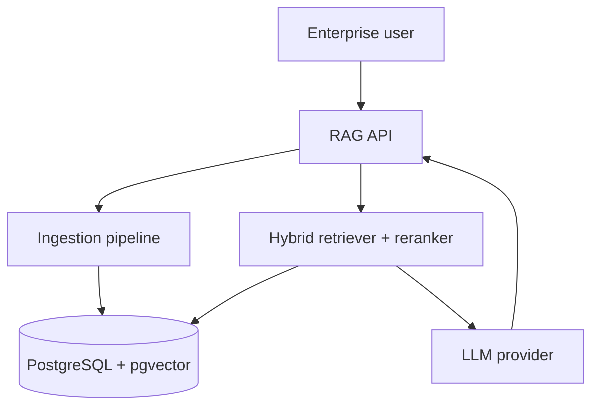

# Architecture

## Context

The domain and application layers own chunking, retrieval contracts, guardrails and citations. Spring AI, JDBC, PostgreSQL and HTTP remain adapters.

## Retrieval

Candidate scoring in v0.1 is `0.70 * cosine_similarity + 0.30 * capped_ts_rank`. This is transparent and reproducible, but not yet a semantic cross-encoder reranker. The next iteration introduces reciprocal-rank fusion and a pluggable reranking port.

## Tenant boundary

All rows carry `tenant_id`; all retrieval SQL requires it. Production hardening requires authenticated tenant derivation plus PostgreSQL RLS policy bound to the transaction context, ensuring defense in depth.
